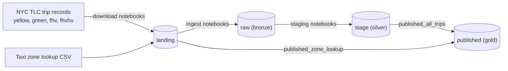

# NYC Taxi Data Pipeline

An end-to-end data engineering project on **Databricks** and **AWS S3**. It takes raw NYC taxi trip files, cleans them in stages, and produces one analytics-ready table that answers business questions about where, when, and how people ride.

The pipeline uses the **medallion architecture** (raw → staging → published) with **Unity Catalog** for governance.

## Data

Source: [NYC Taxi & Limousine Commission (TLC) trip records](https://www.nyc.gov/site/tlc/about/tlc-trip-record-data.page)

| Dataset | What it is |
|---|---|
| Yellow | Traditional NYC yellow cab trips |
| Green | Green cab trips (outer boroughs) |
| FHV | For-hire vehicle trips |
| FHVHV | High-volume for-hire vehicle trips (Uber, Lyft, etc.) |
| Taxi zone lookup | Maps each location ID to a borough, zone, and service zone |

Year: 2023
Months loaded: _TODO: confirm the months in the data (see "Checking data coverage" below)_

## Architecture



| Layer | S3 bucket | Unity Catalog schema | What happens here |
|---|---|---|---|
| Landing | `ims-dbr-landing` | n/a | Source files are dropped here exactly as downloaded |
| Raw (bronze) | `ims-dbr-raw` | `nytaxi.raw` | Parquet copy of the landing data, registered as external tables |
| Stage (silver) | `ims-dbr-stage` | `nytaxi.staging` | Data is typed, cleaned, de-duplicated, and enriched with derived columns |
| Published (gold) | `ims-dbr-published` | `nytaxi.published` | One combined table with zone details, ready for analysis |

All tables are **external tables**: Unity Catalog tracks them, and the data stays in your S3 buckets. Bucket names are globally unique, so use your own names if you rebuild this.

## Repository structure

```
NYC-Taxi-Data-Pipeline/
├── README.md
├── setup/
│   └── create_catalog_and_schemas.sql
└── NYTAXI/
    ├── common/
    │   └── utils                      # shared helper: check_file_exists()
    ├── download/                      # fetch TLC files into landing (one notebook per dataset)
    ├── ingest/                        # landing -> raw (one notebook per dataset)
    ├── staging/                       # raw -> stage (one notebook per dataset)
    └── published/
        ├── published_zone_lookup      # zone lookup -> published
        ├── published_all_trips        # combine all datasets into nytaxi.published.all_trips
        └── published_bus_problems     # business questions in SQL
```

## How the pipeline works

**1. Download.** Each notebook fetches one dataset's monthly parquet files from the TLC site and writes them to `s3://ims-dbr-landing/nytaxi/trip_records/<dataset>/`. The zone lookup CSV sits in `s3://ims-dbr-landing/nytaxi/zone_lookup/`.

**2. Ingest (landing → raw).** Copies the parquet files into the raw bucket and registers `nytaxi.raw.<dataset>_trip_records`. A shared helper (`check_file_exists`) stops the notebook early if the source folder is empty, and `overwrite` mode makes every run safe to repeat.

**3. Staging (raw → stage).** Each dataset goes through the same steps:
- Cast every column to a fixed type
- Derive `trip_duration` (minutes) and pickup/dropoff hour, day of week, year, and month
- Flag trips with unknown zones (location IDs 264 and 265)
- Fill missing values with defaults (for example, passenger count of 1)
- Remove invalid rows
- Remove duplicates

| Dataset | Rows removed if... |
|---|---|
| Yellow, Green | fare ≤ 0, passengers ≤ 0, distance ≤ 0, or duration ≤ 0 |
| FHVHV | zone ID above 265, fare ≤ 0, driver pay ≤ 0, duration ≤ 0, or miles ≤ 0 |
| FHV | none (only duplicates are removed) |

Results are written to `ims-dbr-stage` and registered as `nytaxi.staging.<dataset>_trip_records`.

**4. Published (stage → published).**
- `published_zone_lookup` loads the zone lookup into `nytaxi.published.zone_lookup`.
- `published_all_trips` renames the yellow and green pickup/dropoff columns to match the others, adds a `taxi_type` column, and stacks all four datasets into one table. It then joins the zone lookup twice to add the borough, zone, and service zone for each pickup and dropoff. The result is `nytaxi.published.all_trips`.

`all_trips` keeps only the columns that exist in all four datasets. That makes cross-dataset analysis simple, and the dataset-specific details (tips, distance, passenger count) stay in the staging tables.

**Run order:** download → ingest → staging → `published_zone_lookup` → `published_all_trips` → `published_bus_problems`. The zone lookup must run before `all_trips` because `all_trips` reads from it.

## Business questions

`published_bus_problems` answers three questions with Spark SQL:

1. **Where?** Which pickup and dropoff zones and boroughs are busiest, and how much fare revenue does each generate?
2. **When?** At what hour, day of week, and month are trips and revenue highest?
3. **Which taxi type?** How do the four types compare on total trips, total and average fare revenue, and average trip duration?

## Key findings

_TODO: add results from the business queries (top zones, busiest hours, taxi type comparison)._

## Setup

You need:
- A Databricks workspace with Unity Catalog enabled
- AWS S3 buckets for landing, raw, stage, and published
- A Unity Catalog **external location** for each bucket. They can be created with the Databricks AWS quickstart (Catalog → External Data → Create external location → AWS Quickstart), which also creates the IAM role and storage credential.

Then:
1. Run `setup/create_catalog_and_schemas.sql` to create the `nytaxi` catalog and its three schemas.
2. Update the S3 paths in the notebooks to your own bucket names.
3. Run the notebooks in the order shown above.

## Checking data coverage

To see which months are in the final table:

```sql
SELECT pu_year, pu_month, taxi_type, COUNT(*) AS trips
FROM nytaxi.published.all_trips
GROUP BY pu_year, pu_month, taxi_type
ORDER BY pu_year, pu_month, taxi_type;
```

## Notes and limitations

- **"Revenue" means fare revenue only.** FHV has no fare data, and FHVHV uses the base passenger fare (no tolls, taxes, or tips), so fare totals are not strictly comparable across taxi types.
- **Day of week is numeric**, using Spark's convention: 1 = Sunday through 7 = Saturday.
- **Unknown zones** (IDs 264 and 265) are flagged with `is_pu_unknown` and `is_do_unknown`, not removed. Filter on those flags to exclude them from zone rankings.
- **Invalid rows are dropped silently** in the staging step, and each run reprocesses all data (it is not incremental).

## Tech stack

Databricks · PySpark · Spark SQL · Unity Catalog · AWS S3 · Parquet · Git folders
